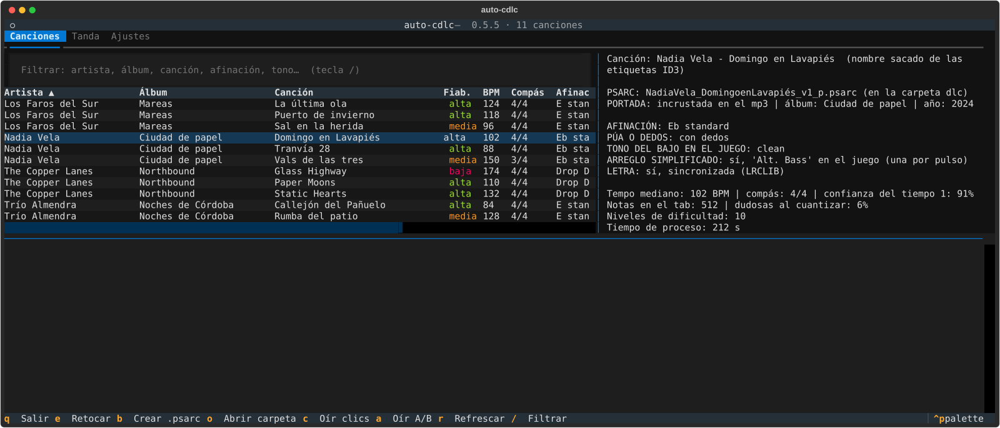
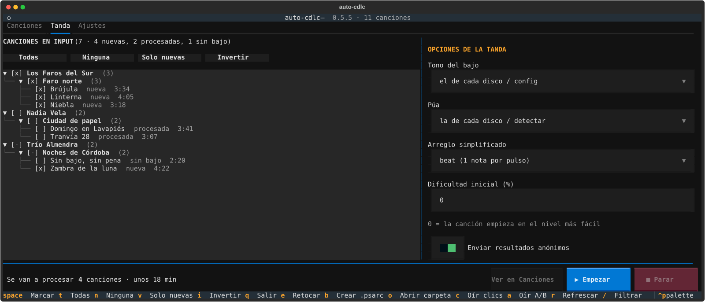
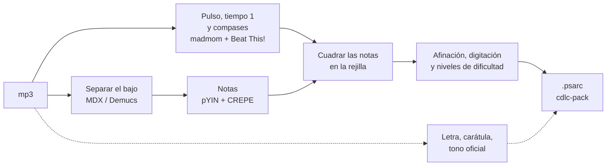

# 🎸 auto-cdlc

**Creador automático de CDLC para Rocksmith 2014: convierte tus mp3 en canciones personalizadas de bajo (`.psarc`), en tu PC y gratis.**

[English](README.md) · **Español**

[**⬇ Descarga la última versión**](https://github.com/fesaje/auto-cdlc/releases/latest) ·
[Instalación](docs/es/instalacion.md) · [Preguntas frecuentes](docs/es/preguntas-frecuentes.md) · [Cambios](CHANGELOG.es.md)

Crea tus propios **CDLC de Rocksmith** con las canciones que ya tienes: metes tus mp3 en una carpeta, lo
ejecutas y sales con canciones personalizadas `.psarc` listas para tocar el bajo en Rocksmith 2014
Remastered, con tablatura, dificultad dinámica, tono, letra y carátula. Todo se calcula en local con modelos de código abierto: sin cuentas, sin pagar
por canción y sin subir tu música a ningún sitio.

## ✨ Qué te da

|  |  |
|---|---|
| 🎼 **Tablatura de bajo** con **dificultad dinámica**, hasta 10 niveles por frase, como las oficiales | 🐢 Un **arreglo simplificado** ("Alt. Bass") para calentar: una nota por compás, medio compás, pulso o corchea |
| 🎛️ El **tono del ampli**: el oficial si el artista tiene DLC, o el que elijas para cada disco | 🎤 **Letra en pantalla**, **carátula**, álbum y año, cuando se encuentran |
| 🎚️ La **afinación** (E, Eb, Drop D, D… hasta B) y una **digitación** que mueve la mano lo mínimo | 📦 El **`.psarc`** listo, sin abrir DLC Builder, directo a la carpeta `dlc` de Rocksmith |
| 🖥️ Una **interfaz de texto** para ver tus canciones, lanzar tandas y cambiar ajustes | ✏️ **Retoques en segundos** (tono, púa, velocidad, dificultad) sin volver a analizar |
| ✅ Una **nota de fiabilidad** para cada canción, y las que conviene revisar aparte | 🔄 **Se actualiza solo**, en español e inglés |

## 🚀 Para empezar

1. **Instala Wwise** (de la 2019 a la 2023: convierte el audio) y el **CDLC Enabler** (deja que el juego
   cargue canciones personalizadas). [Paso a paso](docs/es/instalacion.md).
2. **Descarga** `auto-cdlc-…-windows.zip` de la [última versión](https://github.com/fesaje/auto-cdlc/releases/latest),
   descomprímelo y ejecuta **`install.bat`**. Busca tus instalaciones de Rocksmith y te pregunta dónde
   dejar las canciones.
3. **Mete tus mp3** en `input` y ejecuta **`auto-cdlc.bat`** (la interfaz) o **`process.bat`** (directo,
   con unas pocas preguntas).

Trabaja por **tandas**: agrupa las canciones por artista y disco, pregunta solo lo necesario y después va
solo, de noche si quieres. Unos **3–4 minutos por canción** en un PC normal, sin tarjeta gráfica.

## ⚙️ Cómo funciona

El detalle, para curiosos y para quien quiera colaborar, en [Cómo funciona](docs/es/funcionamiento.md).

## 🔍 Revisar y pulir una canción

Cada canción tiene su carpeta en `output` con todo lo que se usó para crearla:

- **`_AB.mp3`**: con cascos, el bajo real por la izquierda y la tablatura por la derecha. Las notas que
  fallan se notan enseguida.
- **`_clics.mp3`**: un clic en cada pulso, más agudo en el 1, para comprobar los compases.
- **`.gp5`**, **`.svl`**, los **XML** de los arreglos y un **proyecto de DLC Builder**: ábrelos en Guitar
  Pro, TuxGuitar, Editor on Fire o DLC Builder y corrige lo que haga falta. Después vuelve a crear el
  `.psarc` sin reanalizar: `process.bat --rebuild "output\Artista - Título"`.

Es un buen **punto de partida para chartear una canción a mano**: el mapa de pulsos y las notas ya están.

## 📚 Documentación

| | |
|---|---|
| **[Instalación](docs/es/instalacion.md)** | Requisitos, Wwise, CDLC Enabler, instalador y primera prueba |
| **[Preguntas frecuentes](docs/es/preguntas-frecuentes.md)** | Uso, revisar una canción, editar y recompilar, problemas habituales |
| **[Uso](docs/es/uso.md)** | La interfaz, las preguntas de la tanda, lo que sale, cada opción de `config.txt` |
| **[Cómo funciona](docs/es/funcionamiento.md)** | El proceso en detalle |
| **[Cambios](CHANGELOG.es.md)** · **[Software de terceros](TERCEROS.md)** | |

## ⚠️ Limitaciones

- Solo **Windows** (10/11, 64 bits) y **bajo de 4 cuerdas**.
- Es una **transcripción automática**: las líneas de bajo claras salen muy tocables; las muy cargadas,
  sincopadas o con mezcla turbia tendrán notas de más, de menos o fuera de sitio. El swing y los compases
  compuestos (6/8, 12/8) todavía no se llevan bien.
- No detecta técnicas: slides, hammer-ons, slap o armónicos salen como notas normales.

## 💡 Por qué

Toco el bajo con Rocksmith y en las webs habituales de CDLC encontraba muy pocas canciones en español, así
que hice una herramienta para chartear las que nadie ha charteado. Está pensada para **practicar a nivel
personal**.

## 🤝 Ayudar a mejorarlo

Al procesar una tanda puedes enviar un **informe anónimo** de cada canción: el diagnóstico y la tablatura
generada, nunca el audio, la letra ni tus carpetas. Es opcional (`send_results = no` lo desactiva) y es
como mejora la transcripción.

¿Un fallo o una canción que sale mal? Abre una [incidencia](https://github.com/fesaje/auto-cdlc/issues) y
adjunta el **registro de la tanda** (`output\log_….txt`). En español o en inglés, como prefieras.

## 🙏 Hecho con

[Rocksmith2014.NET / DLC Builder](https://github.com/iminashi/Rocksmith2014.NET) ·
[audio-separator](https://github.com/nomadkaraoke/python-audio-separator) ·
[Demucs](https://github.com/facebookresearch/demucs) ·
[madmom](https://github.com/CPJKU/madmom) ·
[Beat This!](https://github.com/CPJKU/beat_this) ·
[librosa](https://github.com/librosa/librosa) ·
[torchcrepe](https://github.com/maxrmorrison/torchcrepe) ·
[LRCLIB](https://lrclib.net) ·
[Textual](https://github.com/Textualize/textual). Lista completa y licencias en [TERCEROS.md](TERCEROS.md).

Si buscabas: crear CDLC para Rocksmith 2014 · hacer tus propios CDLC · canciones personalizadas desde
mp3 · tablatura de bajo automática · psarc · CDLC en español · alternativa gratuita a los generadores de
CDLC de pago.

## ⚖️ Aviso legal y licencia

auto-cdlc no incluye ni descarga música. Está pensado para crear CDLC **de uso personal** a partir de
canciones que ya tienes. No subas tal cual a webs de CDLC lo que genera, ni compartas CDLC de canciones con
derechos sin permiso, sobre todo si existen como DLC oficial.

Rocksmith es una marca de Ubisoft. Este proyecto no tiene relación con Ubisoft ni con CustomsForge.

Código con licencia [MIT](LICENSE). Los modelos de madmom tienen licencia CC BY-NC-SA, así que el programa en
conjunto solo puede usarse **sin fines comerciales**. El software de terceros mantiene sus licencias.
