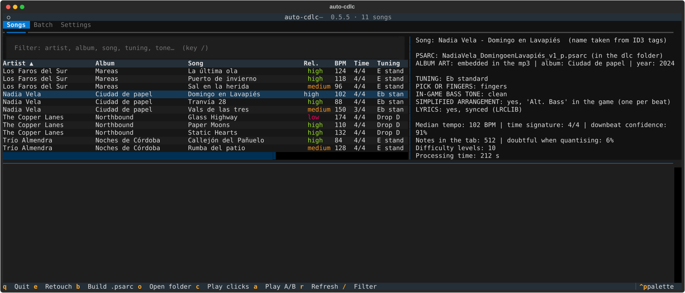
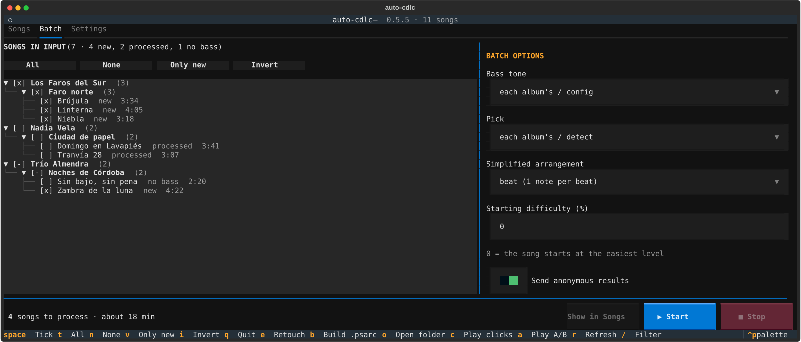
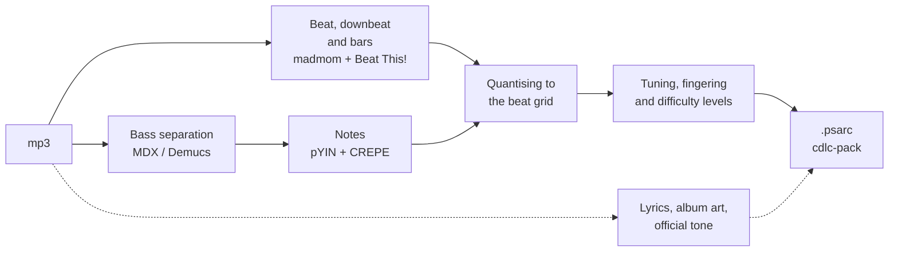

# 🎸 auto-cdlc

**Automatic Rocksmith 2014 CDLC creator: turn your mp3s into playable bass custom songs (`.psarc`), on your own PC, for free.**

**English** · [Español](README.es.md)

[**⬇ Download the latest version**](https://github.com/fesaje/auto-cdlc/releases/latest) ·
[Installation](docs/en/installation.md) · [FAQ](docs/en/faq.md) · [Changelog](CHANGELOG.md)

Make your own **Rocksmith CDLC** from the songs you already have: put your mp3s in a folder, run it and get
`.psarc` custom songs ready to play bass in Rocksmith 2014 Remastered, with tab, dynamic difficulty, tone,
lyrics and album art.
Everything runs locally with open-source models: no accounts, no per-song fees, and your music is never
uploaded anywhere.

## ✨ What you get

|  |  |
|---|---|
| 🎼 **Bass tab** with **dynamic difficulty**, up to 10 levels per phrase, like official songs | 🐢 A **simplified arrangement** ("Alt. Bass") to warm up: one note per bar, half bar, beat or eighth |
| 🎛️ The **amp tone**: the official one when the artist has DLC, or the one you choose per album | 🎤 **On-screen lyrics**, **album art**, album and year, when they can be found |
| 🎚️ The **tuning** (E, Eb, Drop D, D… down to B) and a **fingering** that keeps your hand still | 📦 A ready **`.psarc`**, built without opening DLC Builder, straight into Rocksmith's `dlc` folder |
| 🖥️ A **text interface** to browse your songs, launch batches and change settings | ✏️ **Retouch in seconds** (tone, pick, scroll speed, difficulty) without analysing again |
| ✅ A **reliability rating** for every song, and the ones worth checking listed apart | 🔄 **Self-updating**, in English and Spanish |

## 🚀 Quick start

1. **Install Wwise** (2019 to 2023: it converts the audio) and the **CDLC Enabler** (lets the game load
   custom songs). [Step by step](docs/en/installation.md).
2. **Download** `auto-cdlc-…-windows.zip` from the [latest release](https://github.com/fesaje/auto-cdlc/releases/latest),
   unzip it and run **`install.bat`**. It finds your Rocksmith installs and asks where the songs should go.
3. **Put your mp3s** in `input` and run **`auto-cdlc.bat`** (the interface) or **`process.bat`** (straight
   away, asking a few questions).

It works in **batches**: it groups the songs by artist and album, asks only what it needs and then runs
unattended, overnight if you like. About **3–4 minutes per song** on a regular PC, no graphics card needed.

## ⚙️ How it works

The details, for the curious and for contributors, are in [How it works](docs/en/how-it-works.md).

## 🔍 Checking and polishing a song

Each song gets its own folder in `output` with everything used to build it:

- **`_AB.mp3`**: with headphones, the real bass on the left and the tab on the right. Wrong notes stand out.
- **`_clics.mp3`**: a click on every beat, higher on beat 1, to check the bars.
- **`.gp5`**, **`.svl`**, the arrangement **XMLs** and a **DLC Builder project**: open them in Guitar Pro,
  TuxGuitar, Editor on Fire or DLC Builder and fix what you need. Then rebuild the `.psarc` without
  analysing again: `process.bat --rebuild "output\Artist - Title"`.

It's a good **starting point for charting a song by hand**: the beat map and the notes are already there.

## 📚 Documentation

| | |
|---|---|
| **[Installation](docs/en/installation.md)** | Requirements, Wwise, CDLC Enabler, installer and first test |
| **[FAQ](docs/en/faq.md)** | Using it, checking a song, editing and rebuilding, common problems |
| **[Usage](docs/en/usage.md)** | The interface, the batch questions, the output, every option in `config.txt` |
| **[How it works](docs/en/how-it-works.md)** | The pipeline in detail |
| **[Changelog](CHANGELOG.md)** · **[Third-party software](THIRD_PARTY.md)** | |

## ⚠️ Limitations

- **Windows** only (10/11, 64-bit), **4-string bass** only.
- It's an **automatic transcription**: clear basslines come out very playable; busy, syncopated or muddy
  ones will have extra, missing or misplaced notes. Swing and compound meters (6/8, 12/8) aren't handled
  well yet.
- Techniques aren't detected: slides, hammer-ons, slap and harmonics come out as plain notes.

## 💡 Why

I play bass with Rocksmith and kept finding very few songs in Spanish on the usual CDLC sites, so I built
a tool to chart the songs nobody else has charted. It's meant for **personal practice**.

## 🤝 Helping improve it

When you process a batch, you can send an **anonymous report** for each song: the diagnostics and the
generated tab, never the audio, the lyrics or your folders. It's optional (`send_results = no` turns it
off) and it's how the transcription gets better.

Found a bug or a song that comes out badly? Open an [issue](https://github.com/fesaje/auto-cdlc/issues) and
attach the **batch log** (`output\log_….txt`). English or Spanish, both welcome.

## 🙏 Built on

[Rocksmith2014.NET / DLC Builder](https://github.com/iminashi/Rocksmith2014.NET) ·
[audio-separator](https://github.com/nomadkaraoke/python-audio-separator) ·
[Demucs](https://github.com/facebookresearch/demucs) ·
[madmom](https://github.com/CPJKU/madmom) ·
[Beat This!](https://github.com/CPJKU/beat_this) ·
[librosa](https://github.com/librosa/librosa) ·
[torchcrepe](https://github.com/maxrmorrison/torchcrepe) ·
[LRCLIB](https://lrclib.net) ·
[Textual](https://github.com/Textualize/textual). Full list and licences in [THIRD_PARTY.md](THIRD_PARTY.md).

Searching for: Rocksmith 2014 CDLC creator · make your own CDLC · custom songs from mp3 · automatic bass
tab · psarc · Rocksmith bass tabs · free alternative to paid CDLC generators.

## ⚖️ Legal notice and licence

auto-cdlc doesn't include or download any music. It's meant for making CDLC **for personal use** from songs
you already own. Don't upload the generated charts as they are to CDLC sites, and don't share CDLC of
copyrighted songs without permission, especially songs that exist as official DLC.

Rocksmith is a trademark of Ubisoft. This project isn't affiliated with Ubisoft or CustomsForge.

Code under the [MIT](LICENSE) licence. madmom's models are licensed CC BY-NC-SA, so the program as a whole
may only be used **non-commercially**. Third-party software keeps its own licences.
